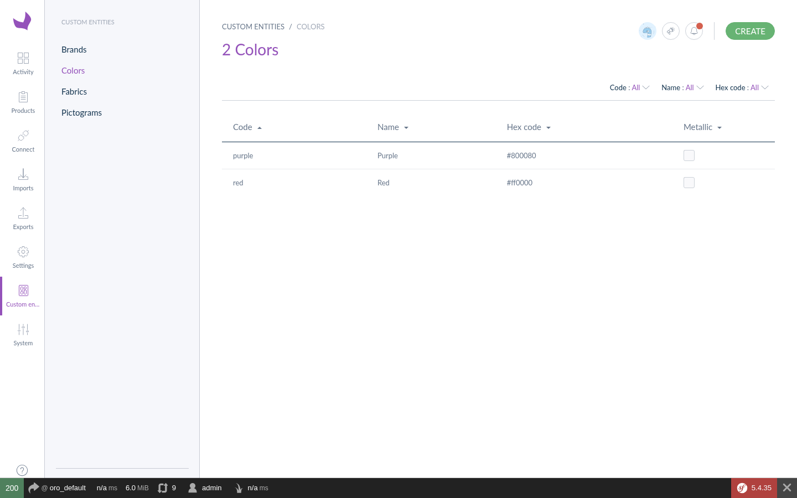
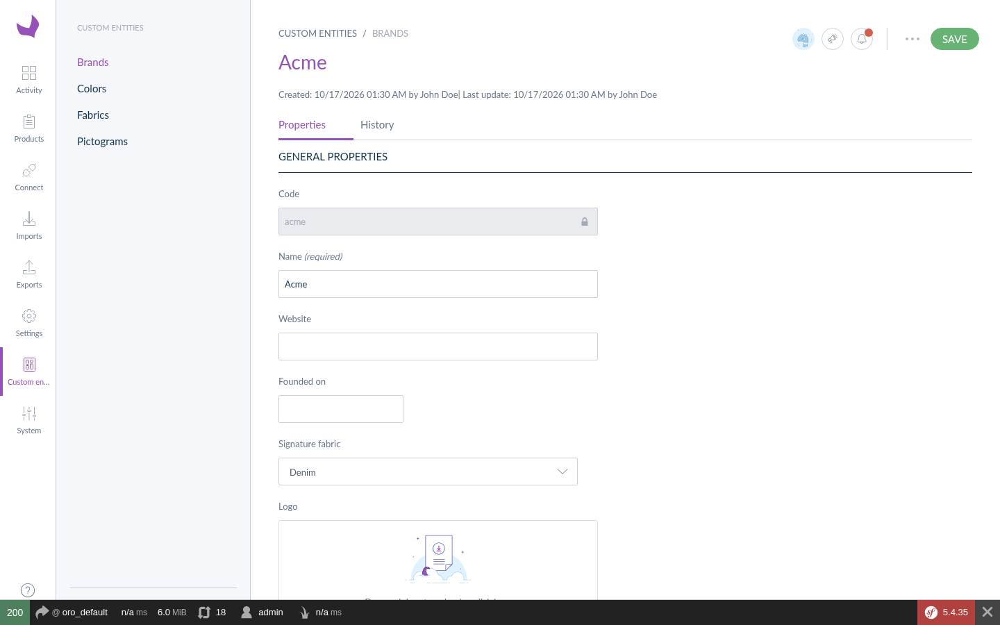

# Akeneo Custom Entity Bundle

Custom entities (reference data) for **Akeneo PIM 7 Community Edition**: declare a Doctrine entity and one line of configuration, and get a complete settings screen for it in the PIM.

A modern, from-scratch reimplementation of the ideas of the unmaintained
[FriendsOfAkeneo/CustomEntityBundle](https://github.com/FriendsOfAkeneo/CustomEntityBundle),
which stopped at Akeneo 4. See [the migration guide](docs/migration-from-custom-entity-bundle.md).

```yaml
# config/packages/danmyers_custom_entity.yml
danmyers_custom_entity:
    entities:
        color:
            class: App\Entity\Color
```

That entry gives you, with no other file to write:

| Feature | Details |
|---|---|
| Menu | A "Custom entities" tab with one item per entity type |
| List page | Datagrid with sortable columns, filters, row edit/delete, pagination |
| Create / edit / delete | Creation modal and edit form, both generated from the Doctrine mapping; translatable labels; history tab |
| Mass actions | Mass delete, and CSV / XLSX quick exports of the selection or of every filtered row |
| Import / export | CSV and XLSX import and export job profiles |
| Product attributes | Registered as Akeneo reference data, so it can back reference data simple/multi select attributes |
| Removal guard | Refuses to delete an entity still used by a product or product model |
| History | Every creation, change and deletion is versioned |
| Permissions | Per-entity ACLs (list, create, edit, delete, history) on the role screen |
| REST API | Internal JSON API used by the screens, with extension events |





## Requirements

- Akeneo PIM Community Edition 7.0
- PHP 8.1+

## Installation

1. Require the package:

    ```bash
    composer require danmyers/akeneo-custom-entity-bundle
    ```

2. Register the bundle in `config/bundles.php`:

    ```php
    DanMyers\CustomEntityBundle\DanMyersCustomEntityBundle::class => ['all' => true],
    ```

3. Import the routes in `config/routes/routes.yml`:

    ```yaml
    danmyers_custom_entity:
        resource: "@DanMyersCustomEntityBundle/Resources/config/routing.yml"
        prefix: /custom-entity
    ```

4. Declare your entities (see [Quick start](#quick-start)), then create their tables and the quick
   export job instances:

    ```bash
    bin/console danmyers:custom-entity:install          # shows the SQL to run
    bin/console danmyers:custom-entity:install --force  # or runs it
    ```

    New installations (`bin/console pim:installer:db`) create both automatically.

5. Rebuild the frontend, as for any Akeneo bundle:

    ```bash
    bin/console pim:installer:assets --symlink --clean
    yarn run update-extensions && yarn run webpack
    ```

## Quick start

### 1. The entity

Extend `AbstractCustomEntity`. It brings the `id`, the unique `code`, the `sortOrder` used by Akeneo
reference data selects, and `created` / `updated` timestamps.

```php
namespace App\Entity;

use DanMyers\CustomEntityBundle\Entity\AbstractCustomEntity;
use DanMyers\CustomEntityBundle\Entity\Repository\CustomEntityRepository;
use Doctrine\ORM\Mapping as ORM;
use Symfony\Component\Validator\Constraints as Assert;

#[ORM\Entity(repositoryClass: CustomEntityRepository::class)]
#[ORM\Table(name: 'app_color')]
class Color extends AbstractCustomEntity
{
    #[ORM\Column(type: 'string', length: 255)]
    #[Assert\NotBlank]
    protected ?string $name = null;

    #[ORM\Column(type: 'string', length: 7, nullable: true)]
    protected ?string $hex = null;

    public static function getLabelProperty()
    {
        return 'name'; // shown in selects, page titles, product attributes
    }

    // getters and setters...
}
```

The entity must be mapped by Doctrine: put it in a bundle's `Entity` directory, or add a mapping in
`config/packages/doctrine.yml`.

### 2. The configuration

```yaml
# config/packages/danmyers_custom_entity.yml
danmyers_custom_entity:
    entities:
        color:
            class: App\Entity\Color
            label: Colors
```

### 3. Done

Run the [installation](#installation) steps 4 and 5. "Colors" appears under the **Custom entities** tab.
To use colors on products, create a *Reference data simple select* attribute and pick `color` as
its reference data.

The [demo bundle](examples/AcmeCustomEntityDemoBundle) shows every kind of field: scalars, dates,
booleans, links to other custom entities, many-to-many links, images and translatable labels.

## How the screens are built

The forms are inferred from the Doctrine mapping of the entity:

| Doctrine mapping | Form field | Grid column | Grid filter |
|---|---|---|---|
| `string` (≤ 255) | text | yes | on the label property |
| `string` (> 255), `text` | textarea | no | |
| `integer`, `smallint`, `bigint`, `decimal`, `float` | number | yes | |
| `boolean` | switch | yes | |
| `date` | date picker | yes | |
| `datetime` | text (ISO 8601) | no | |
| many-to-one to a custom entity | searchable select | yes (code) | |
| many-to-many to a custom entity | searchable multi select | no | |
| many-to-one to Akeneo `FileInfo` | image upload | no | |
| `json`, `array`, other types | not shown | | |

A column that is not nullable and has no default is **required**: it is also asked for in the creation
modal. Validation uses your Symfony constraints; `code` is unique and limited to letters, digits and
underscores.

Override what is inferred per field:

```yaml
danmyers_custom_entity:
    entities:
        color:
            class: App\Entity\Color
            fields:
                hex:
                    label: Hex code   # label of the form field and grid column
                    filter: true      # add a grid filter
                internal_notes:
                    form: false       # hide from the edit form
                    grid: false
                sortOrder:
                    position: 5       # move to the top of the form
```

## Picking several values on products

To add several custom entities at once to a Reference data multi select attribute (search, tick
results across searches, "Select all", add them in one go), install the companion
[danmyers/akeneo-reference-data-picker-bundle](https://github.com/danmyers/akeneo-reference-data-picker-bundle).
It works with any reference data; with custom entities, its search matches every word of the query.

## Generated codes and computed fields

Codes can be derived from the other fields instead of being typed: implement
`CodeGeneratingInterface`. The code is generated once, when the entity is created, then never changes
(products reference it), and an entity generating an existing code is rejected as a duplicate. The
creation popup then asks for every field instead of a code, and imports may leave the `code` column
empty: rows are matched on the generated code.

A mapped property without setter is treated as computed: shown in exports and filters, never edited,
and ignored by imports. Together, for a vehicle labelled "2026 Jeep Wrangler Unlimited (JL)":

```php
#[ORM\Entity(repositoryClass: CustomEntityRepository::class)]
class Vehicle extends AbstractCustomEntity implements CodeGeneratingInterface
{
    #[ORM\Column(type: 'integer')]
    #[Assert\Range(min: 1900, maxPropertyPath: 'maxYear')]
    protected ?int $year = null;

    // make, model, generation columns with setters calling refreshLabel()...

    #[ORM\Column(type: 'string', length: 255)]
    protected string $label = '';          // getter only: computed

    public static function getLabelProperty() { return 'label'; }

    public function generateCode(): string  // "2026_jeep_wrangler_unlimited_jl"
    {
        return implode(' ', array_filter([(string) $this->year, $this->make, $this->model, $this->generation]));
    }

    public function getMaxYear(): int { return (int) date('Y') + 2; }
}
```

Searches (selects, the companion picker) match every word of the query, in any order, against the code and the
label: "wrangler 2025" finds "2025 Jeep Wrangler Unlimited (JL)".

## Translatable entities

Extend `AbstractTranslatableCustomEntity`, use `TranslatableCustomEntityRepository`, and declare the
translation class:

```php
#[ORM\Entity(repositoryClass: TranslatableCustomEntityRepository::class)]
class Pictogram extends AbstractTranslatableCustomEntity
{
    #[ORM\OneToMany(mappedBy: 'foreignKey', targetEntity: PictogramTranslation::class, cascade: ['persist', 'remove'], orphanRemoval: true)]
    protected Collection $translations;

    public function getTranslationFQCN(): string
    {
        return PictogramTranslation::class;
    }
}

#[ORM\Entity]
#[ORM\UniqueConstraint(name: 'pictogram_translation_locale', columns: ['foreign_key', 'locale'])]
class PictogramTranslation extends AbstractCustomEntityTranslation
{
    #[ORM\ManyToOne(targetEntity: Pictogram::class, inversedBy: 'translations')]
    #[ORM\JoinColumn(name: 'foreign_key', nullable: false, onDelete: 'CASCADE')]
    protected $foreignKey;
}
```

Labels are edited per activated locale, shown in the catalog locale in grids, selects and product
attributes, and imported/exported as `label-<locale>` columns.

## Configuration reference

```yaml
danmyers_custom_entity:
    entities:
        color:                        # snake_case name, used in URLs, ACLs and job parameters
            class: App\Entity\Color   # required, extends AbstractCustomEntity
            reference_data: simple    # simple | multi | false; registers it as Akeneo reference data
            label: Colors             # translation key or text; default: humanised name
            acl_prefix: ~             # default: danmyers_custom_entity_<name>
            manager: default          # alias of a service tagged danmyers_custom_entity.manager
            menu: true                # list it in the "Custom entities" menu
            menu_position: 100        # menu order; equal positions are sorted by label
            index_form: ~             # root of a custom form extension tree, see docs/customization.md
            create_form: ~
            edit_form: ~
            datagrid: ~               # name of a custom datagrid; default: generated
            actions:                  # all enabled by default
                create: true
                edit: true
                delete: true
                mass_delete: true
                quick_export: true
                history: true
            fields:
                <property>:
                    label: ~
                    type: ~           # text | textarea | number | boolean | date | datetime | select | multiselect | image
                    form: ~
                    grid: ~
                    filter: ~
                    required: ~
                    position: ~
            options: {}               # free-form, for your own managers, listeners and forms
```

## Permissions

Each entity gets five ACL resources, in the **Custom entities** group of the role screen:
`<prefix>_index`, `_create`, `_edit`, `_delete`, `_history`. They are enforced by the REST API, the
datagrid and the screens (buttons are hidden when denied).

Akeneo grants new ACL resources to roles that have every permission (as for its own new
permissions), so review your roles after declaring a new entity.

## Import and export

Create job profiles from **Imports** / **Exports** with the *Custom Entity Connector*:

| Job | Format |
|---|---|
| Custom entity import in CSV / XLSX | `code;label-en_US;name;hex;colors;sortOrder` |
| Custom entity export in CSV / XLSX | same columns |

Pick the custom entity in the job profile. Rows are matched by `code` (created or updated); links to
other entities use codes (comma separated for collections); images use the file key or a local path.
Invalid rows are skipped and reported like any Akeneo import.

From the command line:

```bash
bin/console akeneo:batch:create-job "Custom Entity Connector" danmyers_custom_entity_csv_import import colors_import '{"custom_entity":"color"}' "Colors import"
```

## Customizing

See [docs/customization.md](docs/customization.md): custom edit forms, normalizers, managers, REST
action events, repositories and datagrids.

## Development

See [docs/development.md](docs/development.md) to work on the bundle in a local PIM, and run the tests:

```bash
PIM_AUTOLOAD_PATH=/path/to/pim/vendor/autoload.php vendor/bin/phpunit
```

## License

[MIT](LICENSE) © Daniel Myers
